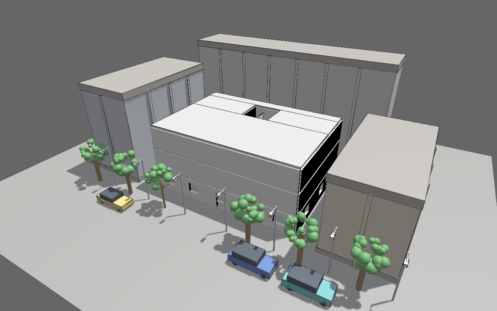
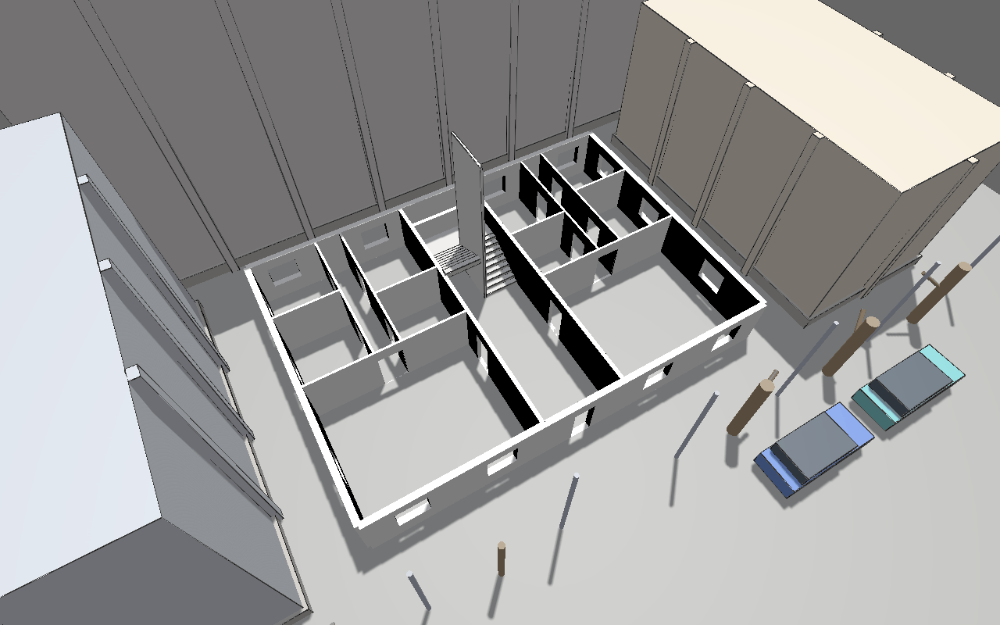
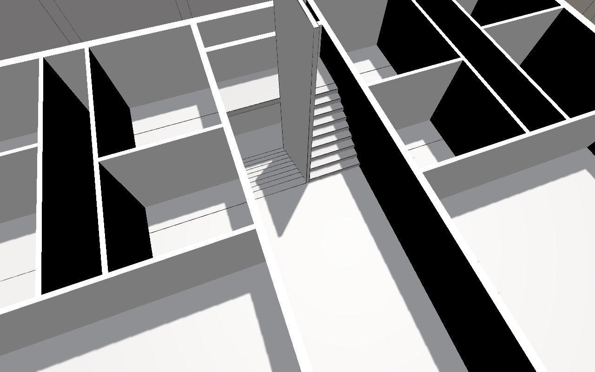
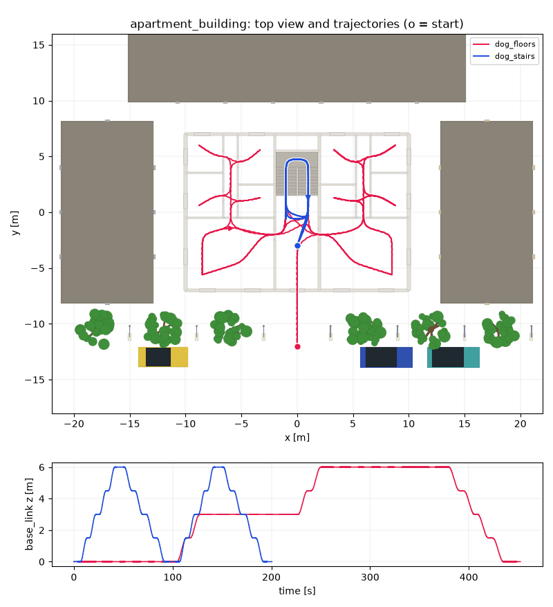

# apartment_building

A newly built three-storey apartment building (20 x 14 m, 3.0 m floor to floor, 2.75 m ceilings) with a dog-leg stair (two flights of 9 steps, 16.7 cm risers, 28 cm treads, a half landing and a central wall) in a central core, and two empty apartments per floor (living room, corridor, two bedrooms, kitchen, bathroom): bare walls, floors, ceilings, door and window openings, no furniture. Stresses stairs for a legged robot, identical floors (vertical ambiguity), small bare rooms with short ranges and door transitions.

Extent of the plotted area: 44 x 34 m; 552 ray-traced primitives.







| trajectory | carrier | duration | length | max speed | max pitch / roll | z range | description |
|---|---|---|---|---|---|---|---|
| `dog_floors` | dog | 7:32 | 273 m | 1.4 m/s | 29 / 2 deg | 6.0 m | Robot dog: from the street up both storeys, through the rooms of one apartment per floor, and back down |
| `dog_stairs` | dog | 3:21 | 121 m | 1.6 m/s | 29 / 2 deg | 6.0 m | Robot dog: fast up and down the dog-leg stair, ground floor to top floor and back, twice |

Regenerate only this world:

```bash
tools/build_worlds.py apartment_building
tools/generate.py --worlds apartment_building
```
