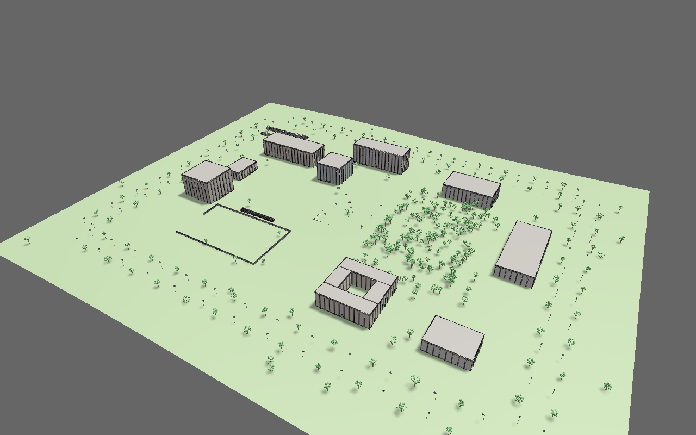
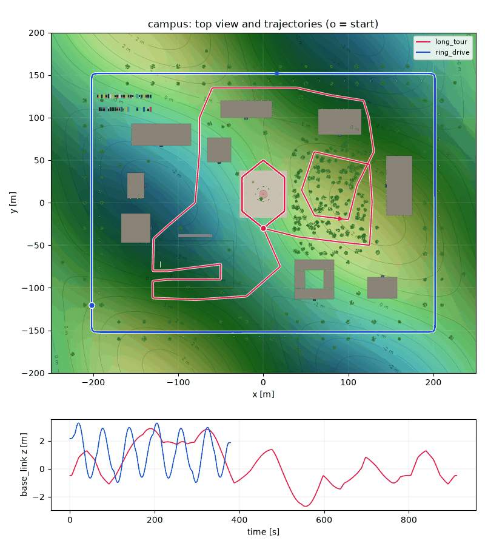

# campus

A 500 x 400 m university campus on gently rolling ground (+-3 m): nine buildings (one with a courtyard, a 25 m tower), a central plaza with a fountain and benches, a tree-lined ring road with lamp posts, about 300 trees (most in a park), a car park, and a fenced sports field with goals and bleachers. Mixed structure and vegetation at large scale; long sequences with loops.

Extent of the plotted area: 500 x 400 m; 11507 ray-traced primitives.





| trajectory | carrier | duration | length | max speed | max pitch / roll | z range | description |
|---|---|---|---|---|---|---|---|
| `long_tour` | ugv | 15:13 | 1796 m | 2.0 m/s | 2 / 2 deg | 5.6 m | UGV, 2 m/s, plaza, park, buildings, sports field and the plaza again (loop closures) |
| `ring_drive` | car | 6:19 | 2792 m | 8.0 m/s | 2 / 2 deg | 4.2 m | Car, 8 m/s, two laps of the ring road |

Regenerate only this world:

```bash
tools/build_worlds.py campus
tools/generate.py --worlds campus
```
