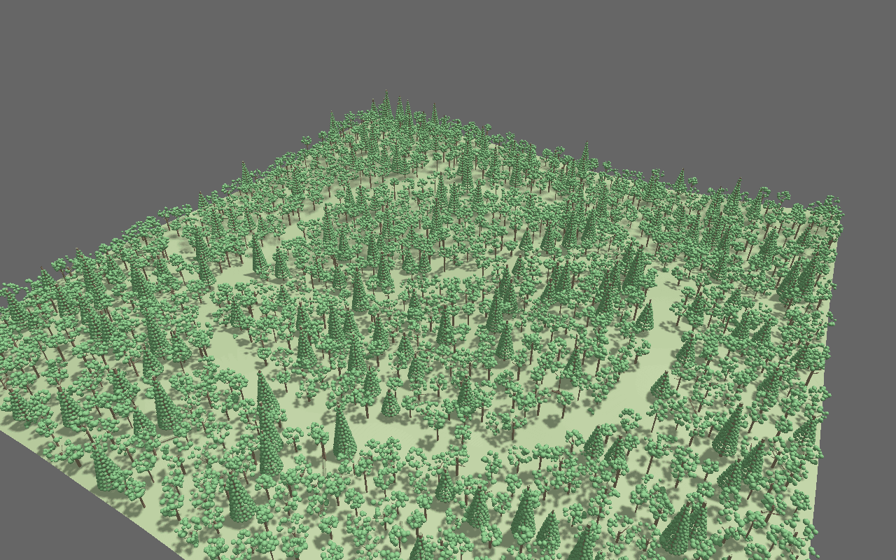
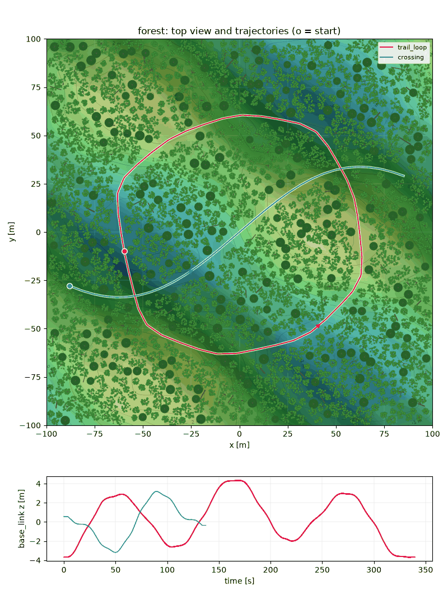

# forest

200 x 200 m of hilly woodland (+-5 m, slopes up to 25%) with about 1350 trees (porous sphere-cluster crowns, branches, some conifers), bushes and fallen logs. Two cleared trails. Stresses unstructured, vegetation-like clutter with few planar surfaces, plus pitch/roll on slopes.

Extent of the plotted area: 200 x 200 m; 61967 ray-traced primitives.





| trajectory | carrier | duration | length | max speed | max pitch / roll | z range | description |
|---|---|---|---|---|---|---|---|
| `trail_loop` | legged | 5:40 | 425 m | 1.5 m/s | 12 / 11 deg | 8.0 m | Legged robot, one lap of the main trail, 1.2 m/s |
| `crossing` | ugv | 2:17 | 195 m | 1.5 m/s | 11 / 10 deg | 6.4 m | UGV across the forest on the second trail, 1.5 m/s |

Regenerate only this world:

```bash
tools/build_worlds.py forest
tools/generate.py --worlds forest
```
