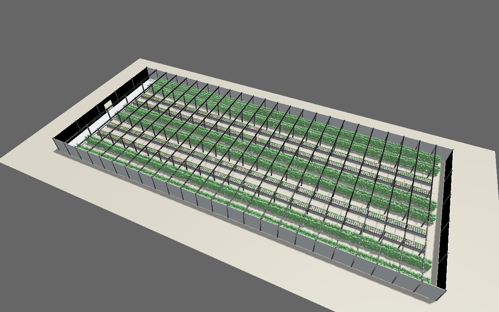
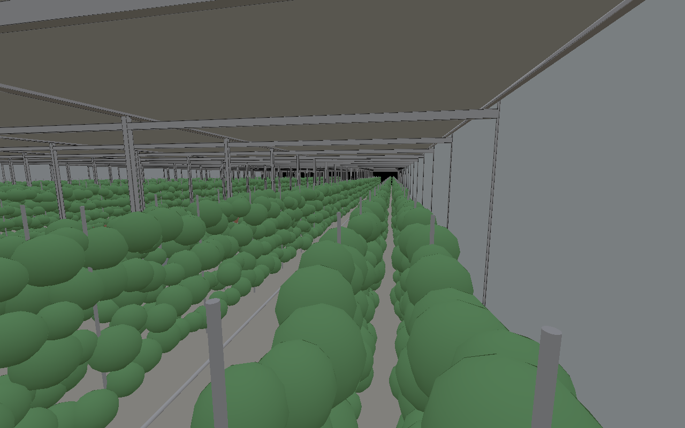
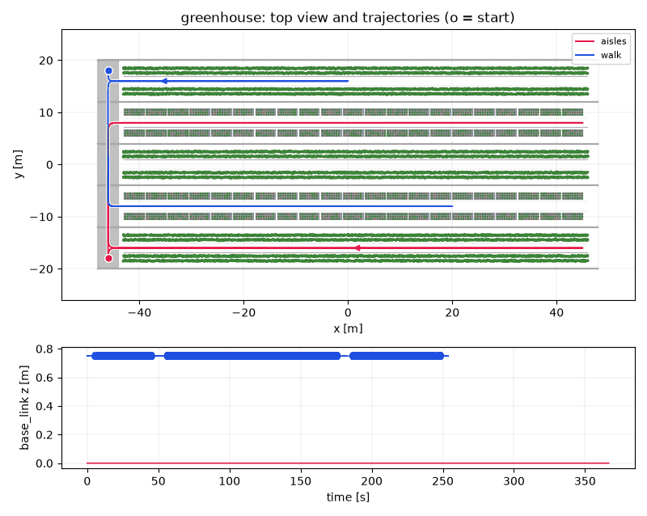

# greenhouse

A 96 x 40 m multi-span greenhouse (5 spans of 8 m, gutters at 4.5 m, gable roofs up to 5.8 m seen from inside), a post grid every 4 m, trusses, and long crop rows: porous tomato-like hedges in three spans and benches with pots in two. Repetitive along the 87 m aisles, where every section looks the same; indoor with a sloped ceiling.

Extent of the plotted area: 110 x 52 m; 16883 ray-traced primitives.






| trajectory | carrier | duration | length | max speed | max pitch / roll | z range | description |
|---|---|---|---|---|---|---|---|
| `aisles` | ugv | 6:07 | 414 m | 1.2 m/s | 0 / 0 deg | 0.0 m | UGV, 1.2 m/s, down and back two 87 m aisles |
| `walk` | handheld | 4:14 | 265 m | 1.2 m/s | 1 / 1 deg | 0.0 m | Handheld rig, partial walks along two other aisles |

Regenerate only this world:

```bash
tools/build_worlds.py greenhouse
tools/generate.py --worlds greenhouse
```
