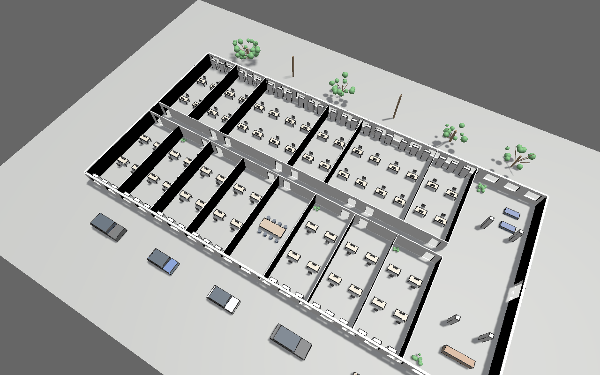
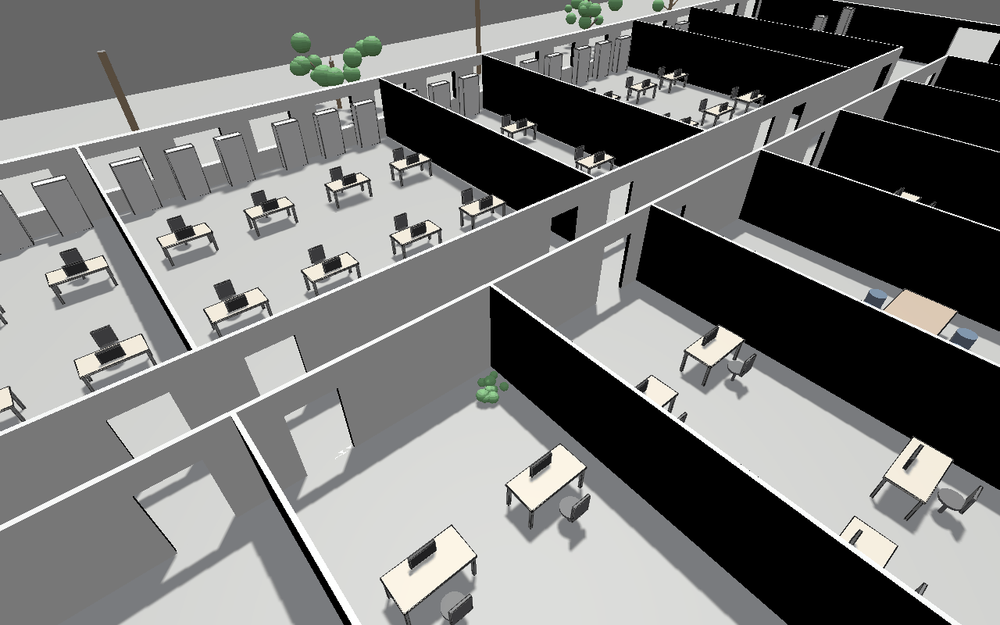
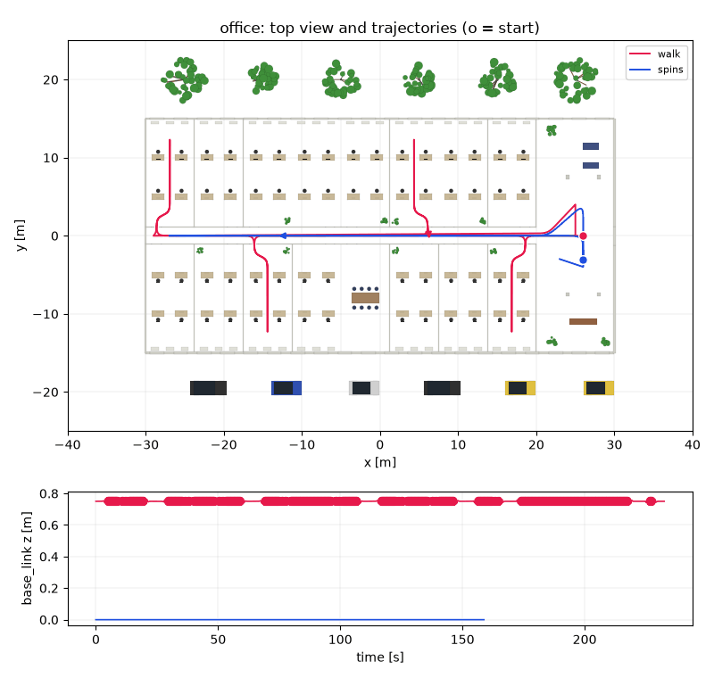

# office

One office floor, 60 x 30 m with a 2.8 m ceiling: a 50 m long, 2.2 m wide corridor, 16 rooms behind 1.2 m doors (desks with legs, chairs, shelves, a meeting room), an open lobby with columns, and windows to an outside with a few trees and cars. Stresses the long-corridor degeneracy, very short ranges in rooms, door transitions and fast in-place rotations.

Extent of the plotted area: 80 x 50 m; 1177 ray-traced primitives.






| trajectory | carrier | duration | length | max speed | max pitch / roll | z range | description |
|---|---|---|---|---|---|---|---|
| `walk` | handheld | 3:53 | 226 m | 1.3 m/s | 1 / 2 deg | 0.1 m | Handheld rig: corridor, two rooms through their doors, lobby |
| `spins` | ugv | 2:39 | 120 m | 1.0 m/s | 0 / 0 deg | 0.0 m | UGV along the corridor with fast in-place spins (90 deg/s) |

Regenerate only this world:

```bash
tools/build_worlds.py office
tools/generate.py --worlds office
```
