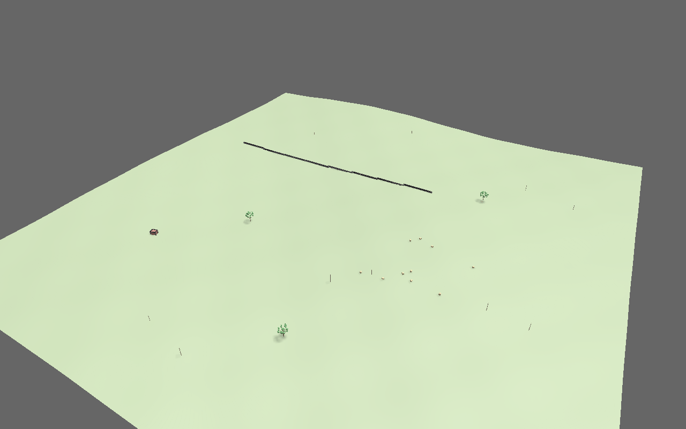
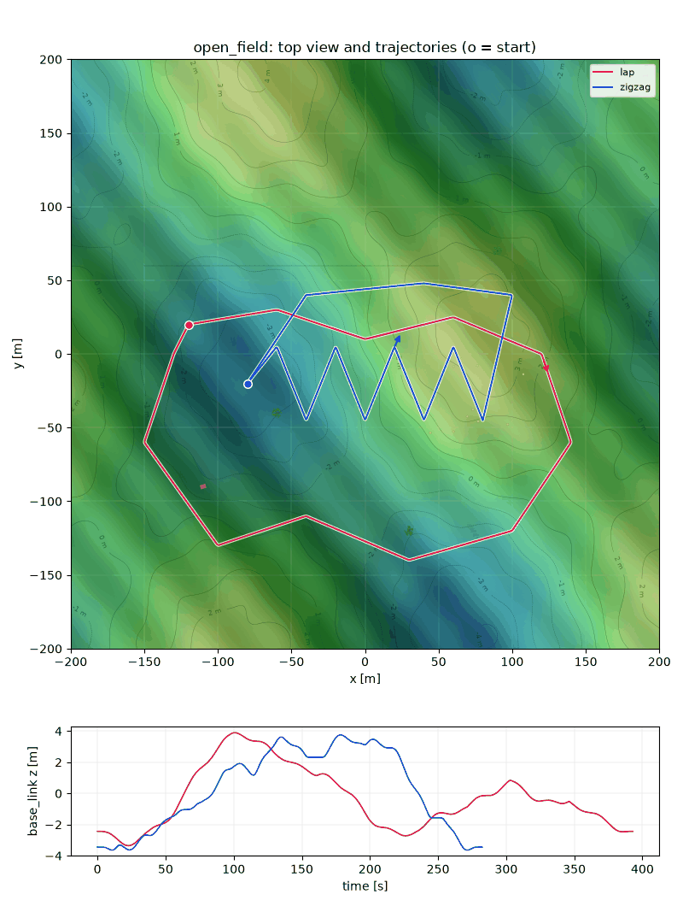

# open_field

400 x 400 m of gently rolling grassland (+-4 m) with very few features: a dozen poles, a fence line, three lone trees, hay bales and a small shed. Stresses horizontal degeneracy: the ground constrains z, roll and pitch, but x, y and yaw rest on a handful of distant objects.

Extent of the plotted area: 400 x 400 m; 246 ray-traced primitives.





| trajectory | carrier | duration | length | max speed | max pitch / roll | z range | description |
|---|---|---|---|---|---|---|---|
| `lap` | ugv | 6:33 | 769 m | 2.0 m/s | 5 / 4 deg | 7.2 m | UGV lap through the field, 2 m/s |
| `zigzag` | ugv | 4:42 | 702 m | 3.0 m/s | 5 / 5 deg | 7.4 m | UGV zig-zag at 3 m/s, tight turns and in-place spins |

Regenerate only this world:

```bash
tools/build_worlds.py open_field
tools/generate.py --worlds open_field
```
