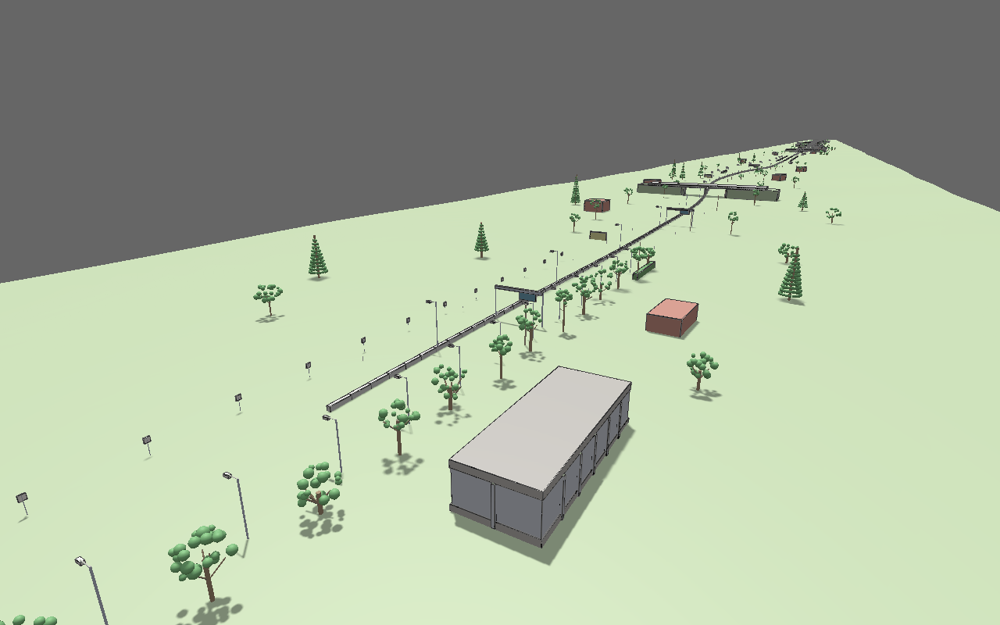
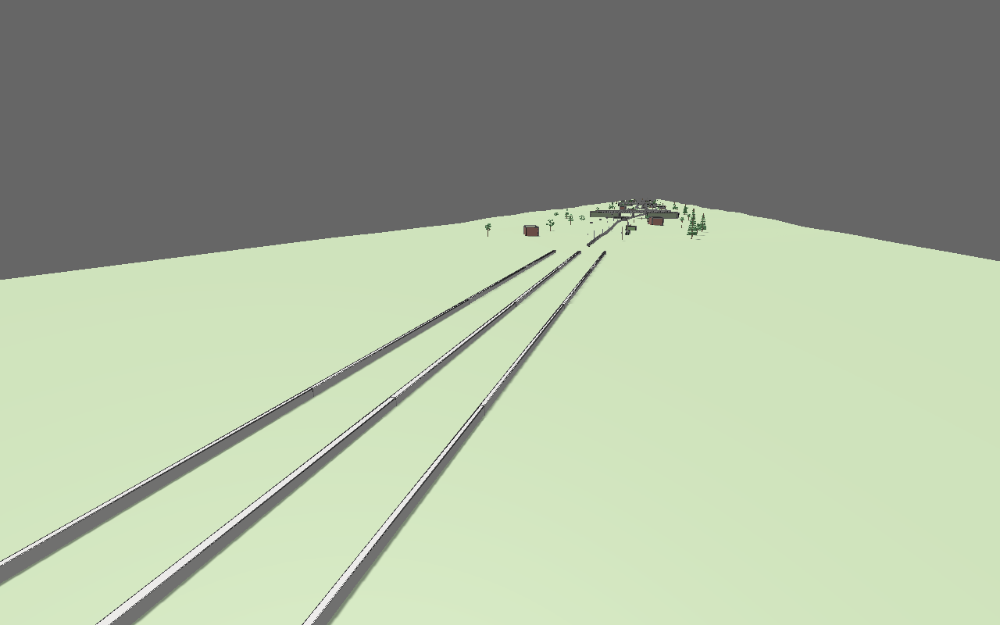
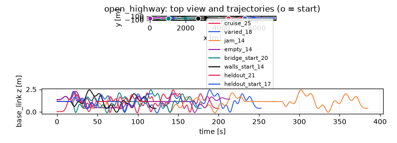

# open_highway

7 km of divided highway at 14-25 m/s. Ordinary stretches (median barrier, reflector posts, lamp posts, sign gantries, overpasses, trees, buildings, gentle bends) alternate with stretches whose only geometry is invariant along the road, as on a long bridge or between noise walls: flat deck, continuous barriers or walls, nothing else in range. Along-track motion is unobservable there and LiDAR odometry under-estimates the distance traveled. The first 4.2 km are for training trajectories; the last 2.6 km, with other kinds of invariant stretch, for a held-out one. Every trajectory but one has moving traffic: vehicles ahead of and behind the car that stop and start with it, the two lanes beside it as queues or as faster and slower streams, and oncoming vehicles on the other carriageway. A vehicle that keeps its place near the car stalls LiDAR odometry that has no other motion source, in the ordinary stretches too.

Extent of the plotted area: 7120 x 260 m; 14417 ray-traced primitives.

The data of this world is not part of the hosted set: render it with the commands below.

Sequences of this world have moving vehicles (`tools/mvsim_lio/traffic.py`): rendering needs an MVSim whose `mvsim-dataset-gen` has `--moving-block`.






| trajectory | carrier | duration | length | max speed | max pitch / roll | z range | description |
|---|---|---|---|---|---|---|---|
| `cruise_25` | car_highway | 3:20 | 4210 m | 25.0 m/s | 1 / 1 deg | 2.6 m | Training part of the highway at 25 m/s |
| `varied_18` | car_highway | 4:13 | 4210 m | 20.4 m/s | 1 / 1 deg | 2.6 m | Training part at 14-22 m/s, with speed changes inside the invariant stretches |
| `jam_14` | car_highway | 6:25 | 4210 m | 14.0 m/s | 1 / 1 deg | 2.6 m | Training part at 14 m/s with a 30 s and a 20 s stop, one inside each invariant stretch |
| `empty_14` | car_highway | 3:34 | 1805 m | 14.0 m/s | 1 / 1 deg | 2.4 m | First 1.8 km at 14 m/s with no other vehicle; a 25 s stop in an ordinary stretch and one inside the bridge |
| `bridge_start_20` | car_highway | 2:58 | 3177 m | 20.0 m/s | 1 / 1 deg | 2.6 m | Starts at rest inside the bridge (150 m of it ahead), then 20 m/s |
| `walls_start_14` | car_highway | 2:03 | 1503 m | 14.0 m/s | 1 / 1 deg | 2.5 m | Starts at rest between the noise walls (120 m of them ahead), then 14 m/s |
| `heldout_21` | car_highway | 2:29 | 2608 m | 23.0 m/s | 1 / 1 deg | 2.0 m | Held-out part of the highway (other kinds of invariant stretch) at 16-23 m/s |
| `heldout_start_17` | car_highway | 1:58 | 1705 m | 17.0 m/s | 1 / 1 deg | 2.0 m | Held-out part: starts at rest on the bridge with lamps (150 m of it ahead), then 17 m/s |

Regenerate only this world:

```bash
tools/build_worlds.py open_highway
tools/generate.py --worlds open_highway
```
