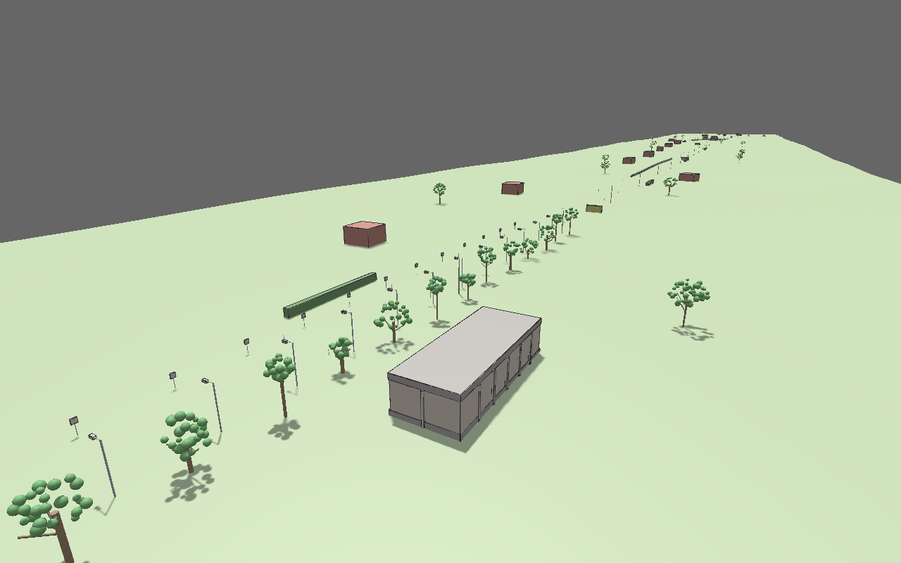
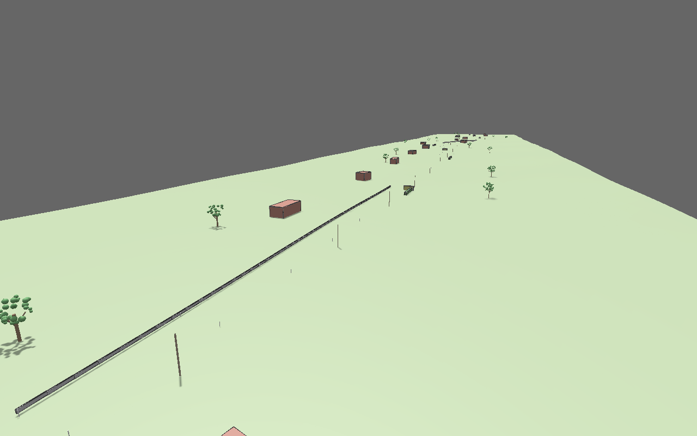
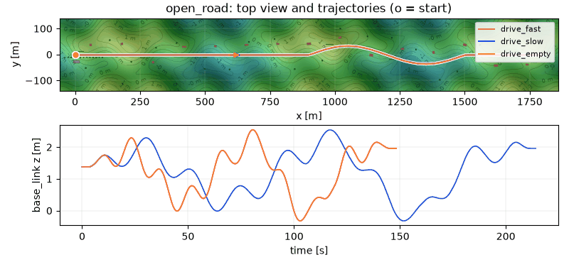

# open_road

A 1.8 km two-lane road through open farmland at 9-14 m/s, with little beside it: reflector posts every 30 m, utility poles, two guardrail stretches, and lone trees, sheds, hedges and billboards far apart. The ground constrains z, roll and pitch, but along-track motion rests on a handful of posts and distant objects: the weak along-track constraint of real open roads. A farmyard at the start gives the first 100 m more structure. Sparse moving traffic, except in one sequence: a vehicle ahead and behind in the car's lane and oncoming vehicles.

Extent of the plotted area: 1920 x 280 m; 1664 ray-traced primitives.

The data of this world is not part of the hosted set: render it with the commands below.

Sequences of this world have moving vehicles (`tools/mvsim_lio/traffic.py`): rendering needs an MVSim whose `mvsim-dataset-gen` has `--moving-block`.






| trajectory | carrier | duration | length | max speed | max pitch / roll | z range | description |
|---|---|---|---|---|---|---|---|
| `drive_fast` | car | 2:28 | 1819 m | 14.0 m/s | 1 / 1 deg | 2.9 m | Car along the road at 14 m/s, gentle S bend |
| `drive_slow` | car | 3:34 | 1819 m | 9.0 m/s | 1 / 1 deg | 2.9 m | Same road at 9 m/s |
| `drive_empty` | car | 2:28 | 1819 m | 14.0 m/s | 1 / 1 deg | 2.9 m | Car along the road at 14 m/s, no other vehicle |

Regenerate only this world:

```bash
tools/build_worlds.py open_road
tools/generate.py --worlds open_road
```
