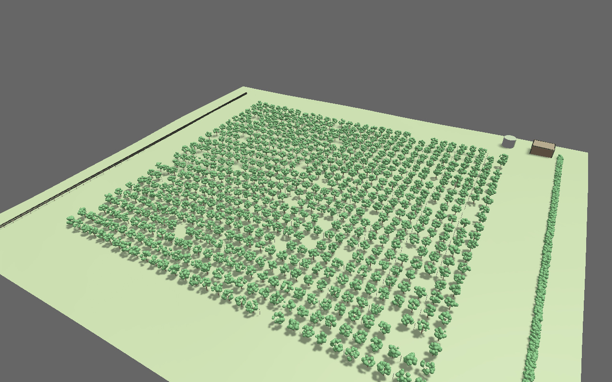
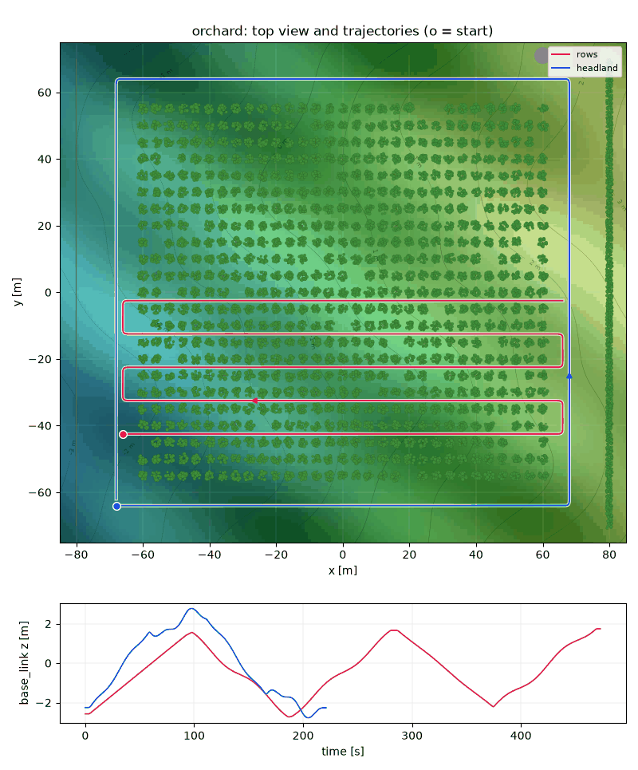

# orchard

23 rows x 31 fruit trees (5 m between rows, 4 m within a row) on a gently sloped field (3%; ~4% of the trees missing), with trellis posts, a perimeter farm track, a hedge, a fence, a shed and a water tank. Highly repetitive along and across the rows (aliasing); the LiDAR sees trunks under the crowns.

Extent of the plotted area: 170 x 150 m; 21744 ray-traced primitives.





| trajectory | carrier | duration | length | max speed | max pitch / roll | z range | description |
|---|---|---|---|---|---|---|---|
| `rows` | ugv | 7:53 | 696 m | 1.5 m/s | 3 / 3 deg | 4.5 m | UGV, 1.5 m/s, along five inter-row lanes with headland turns |
| `headland` | ugv | 3:41 | 525 m | 2.5 m/s | 2 / 3 deg | 5.5 m | UGV, 2.5 m/s, one lap of the perimeter track |

Regenerate only this world:

```bash
tools/build_worlds.py orchard
tools/generate.py --worlds orchard
```
