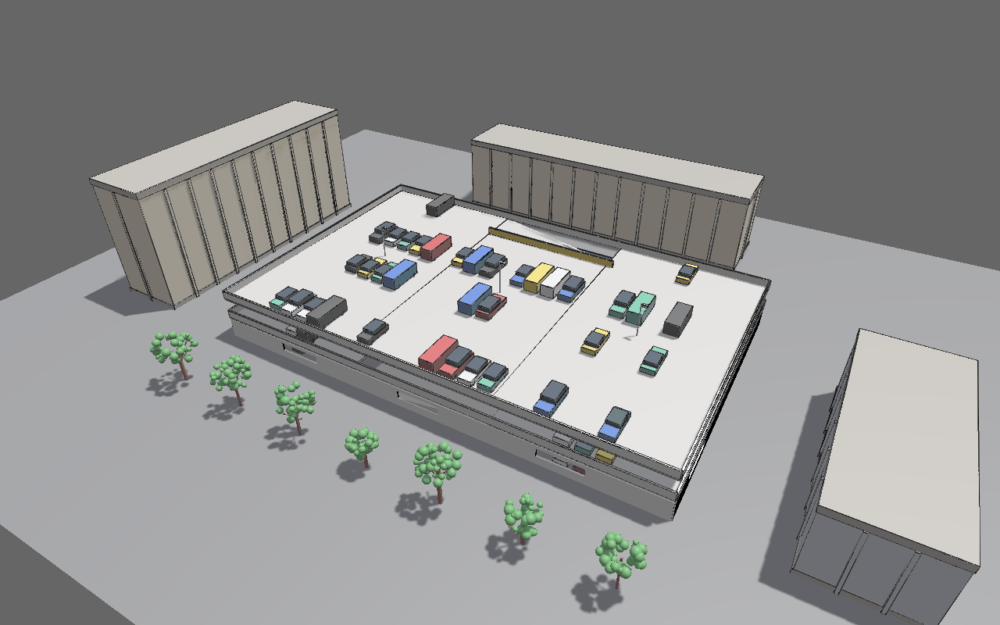
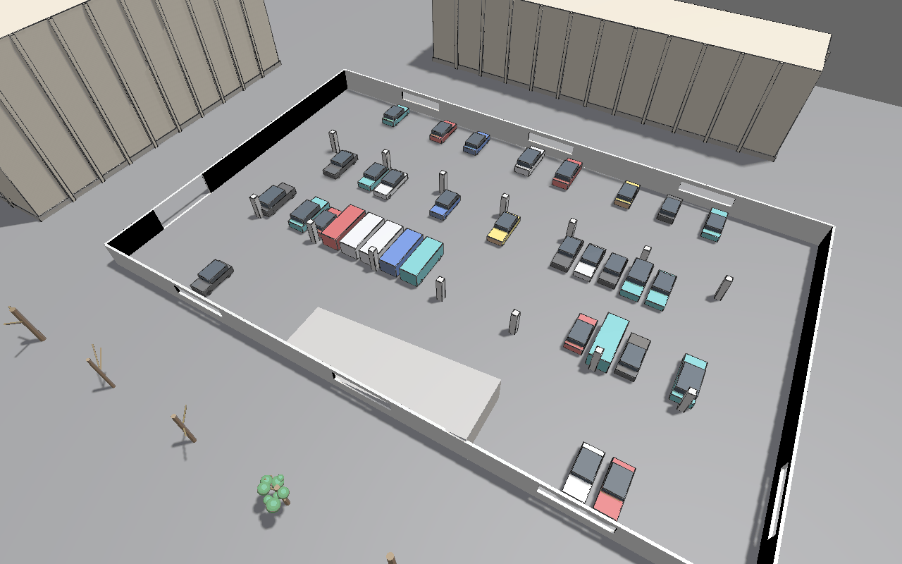
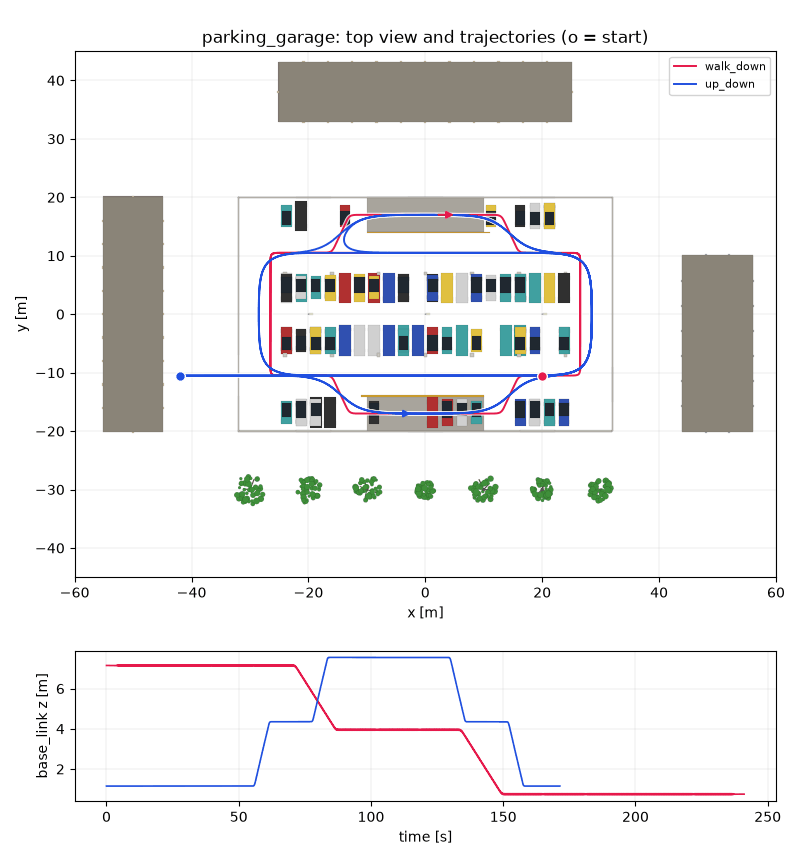

# parking_garage

A three-level parking structure (64 x 40 m, levels at 0, 3.2 and 6.4 m, 2.9 m clearance) linked by two 20 m ramps (16% grade), with a column grid, parapets, an open roof level, ~60% occupied bays, and a few buildings and trees around it. Stresses multi-level geometry with ceilings, ramps (pitch), repetitive columns, and vertical drift between floors.

Extent of the plotted area: 120 x 90 m; 1043 ray-traced primitives.






| trajectory | carrier | duration | length | max speed | max pitch / roll | z range | description |
|---|---|---|---|---|---|---|---|
| `walk_down` | handheld | 4:01 | 315 m | 1.5 m/s | 10 / 2 deg | 6.5 m | Handheld rig from the roof down both ramps to the ground |
| `up_down` | car | 2:51 | 565 m | 3.5 m/s | 9 / 0 deg | 6.4 m | Car, 3.5 m/s: ground lap, up two ramps, roof lap, back down |

Regenerate only this world:

```bash
tools/build_worlds.py parking_garage
tools/generate.py --worlds parking_garage
```
