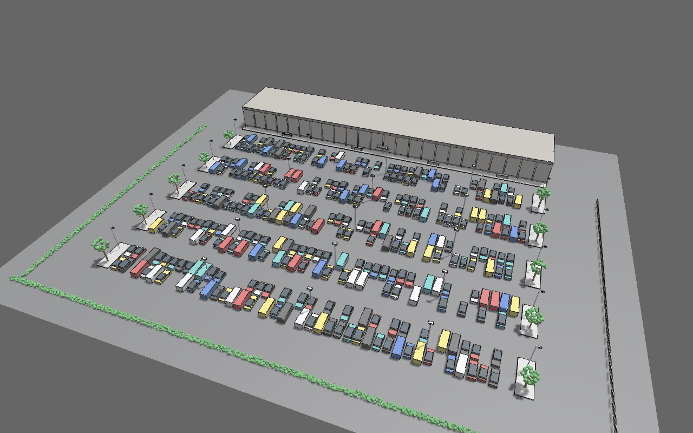
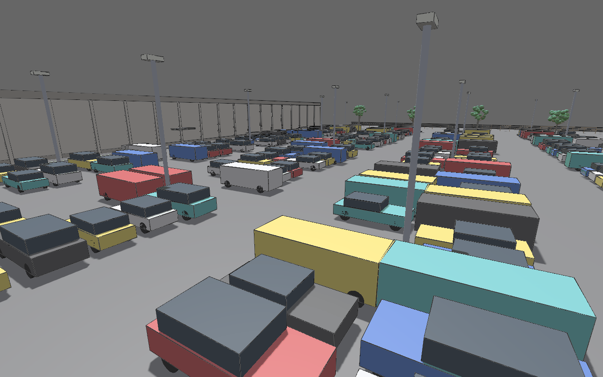
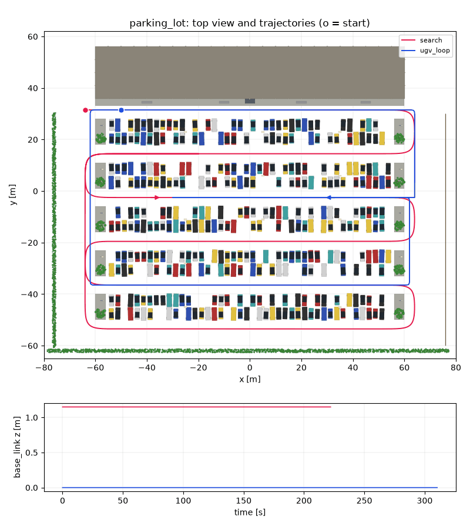

# parking_lot

A 160 x 120 m open-air parking lot in front of a 120 m long supermarket: five double rows of perpendicular bays (~70% occupied by cars of four sizes), curbed end islands with trees, tall light poles, cart corrals, hedges and a fence. Repetitive rows of similar cars; large open aisles.

Extent of the plotted area: 160 x 127 m; 4926 ray-traced primitives.






| trajectory | carrier | duration | length | max speed | max pitch / roll | z range | description |
|---|---|---|---|---|---|---|---|
| `search` | car | 3:42 | 934 m | 4.5 m/s | 0 / 0 deg | 0.0 m | Car, 4.5 m/s, snaking through all six aisles, then a revisit |
| `ugv_loop` | ugv | 5:10 | 569 m | 2.0 m/s | 0 / 0 deg | 0.0 m | UGV, 2 m/s, store front and aisles, with in-place spins |

Regenerate only this world:

```bash
tools/build_worlds.py parking_lot
tools/generate.py --worlds parking_lot
```
