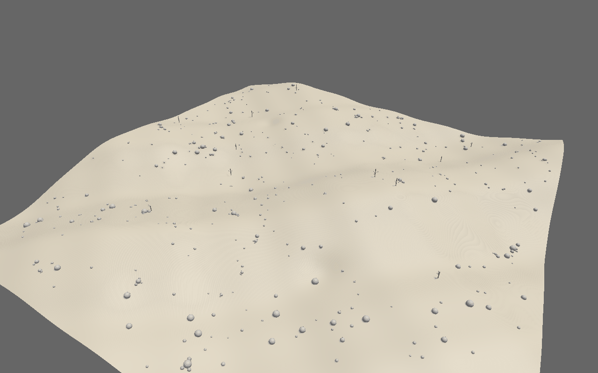
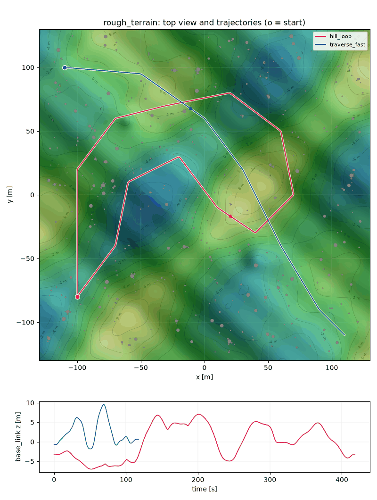

# rough_terrain

260 x 260 m of steep, bumpy hills and valleys (+-10 m, slopes up to 26 deg, with 0.6 m bumps) with two craters, ~400 boulders of 0.3-1.6 m and a few dead trees. Stresses large, fast-changing pitch and roll, and a scene made almost only of terrain and rocks (no planes or poles).

Extent of the plotted area: 260 x 260 m; 638 ray-traced primitives.





| trajectory | carrier | duration | length | max speed | max pitch / roll | z range | description |
|---|---|---|---|---|---|---|---|
| `hill_loop` | ugv | 6:58 | 623 m | 1.6 m/s | 22 / 19 deg | 14.1 m | UGV, 1.5 m/s, a loop over ridges and through a crater |
| `traverse_fast` | ugv | 1:57 | 329 m | 3.2 m/s | 22 / 13 deg | 11.4 m | UGV, 3 m/s, diagonal traverse across the hills |

Regenerate only this world:

```bash
tools/build_worlds.py rough_terrain
tools/generate.py --worlds rough_terrain
```
