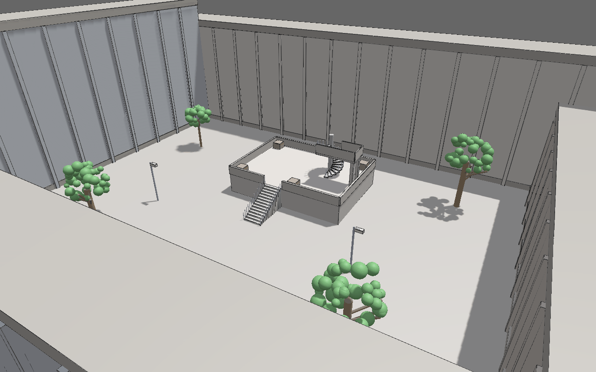
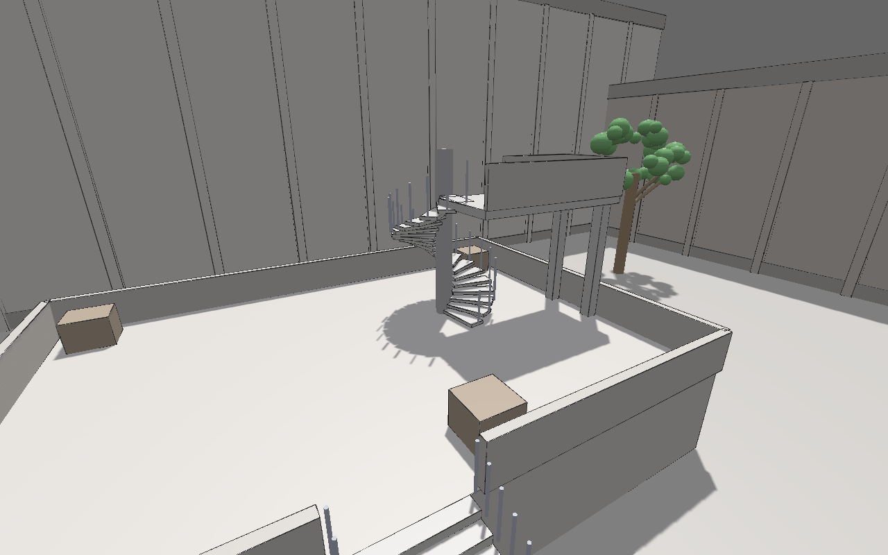
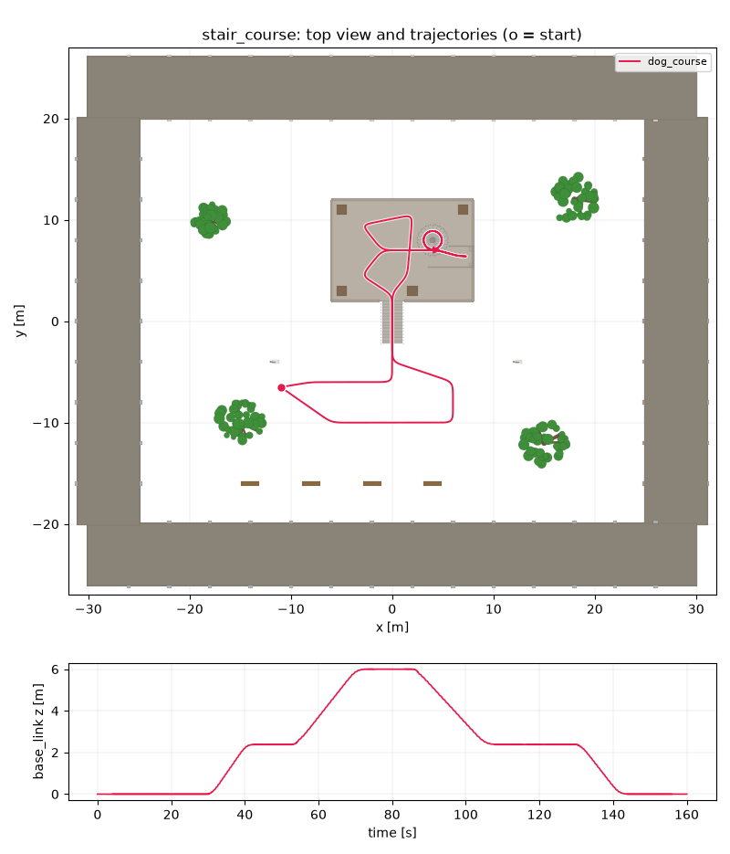

# stair_course

An urban courtyard (60 x 50 m, facades all around) with two stair types for a legged robot: a straight, 2 m wide outdoor flight of 14 steps (17 cm risers, 30 cm treads) up to a 2.38 m terrace with parapets, and a spiral stair (20 steps of 18 cm, one full turn around a central column, floating treads and railing posts) from the terrace up to a 6 m platform on columns. Stresses straight and helical stair climbing and descending, with large, continuous yaw on the spiral.

Extent of the plotted area: 64 x 54 m; 408 ray-traced primitives.






| trajectory | carrier | duration | length | max speed | max pitch / roll | z range | description |
|---|---|---|---|---|---|---|---|
| `dog_course` | dog | 2:40 | 110 m | 1.5 m/s | 30 / 2 deg | 6.0 m | Robot dog: courtyard, straight flight up, spiral up to the platform, spiral and flight back down |

Regenerate only this world:

```bash
tools/build_worlds.py stair_course
tools/generate.py --worlds stair_course
```
