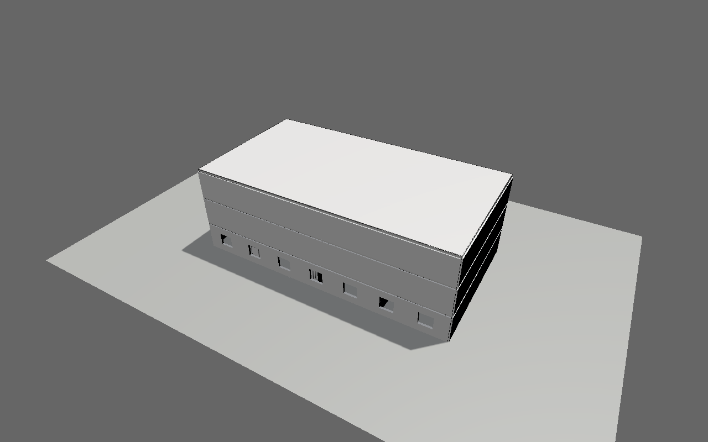
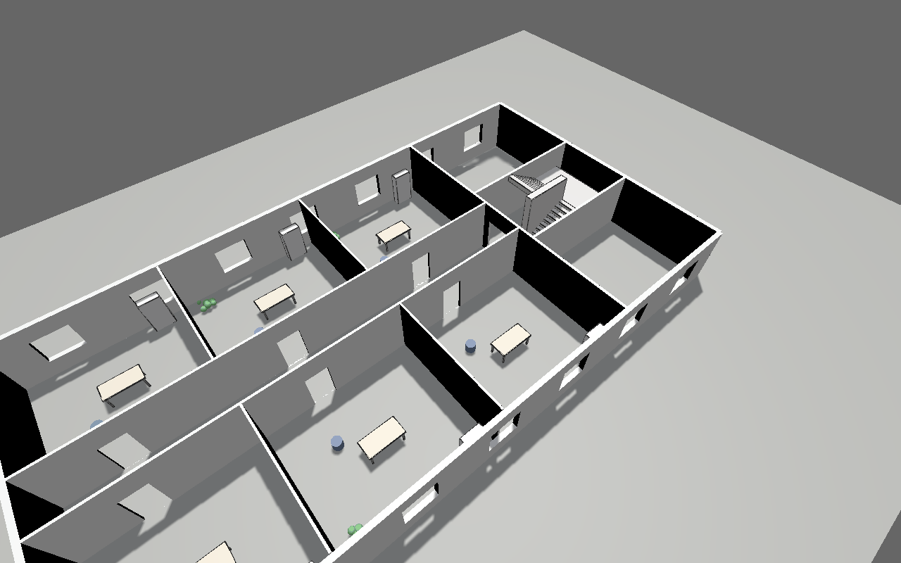
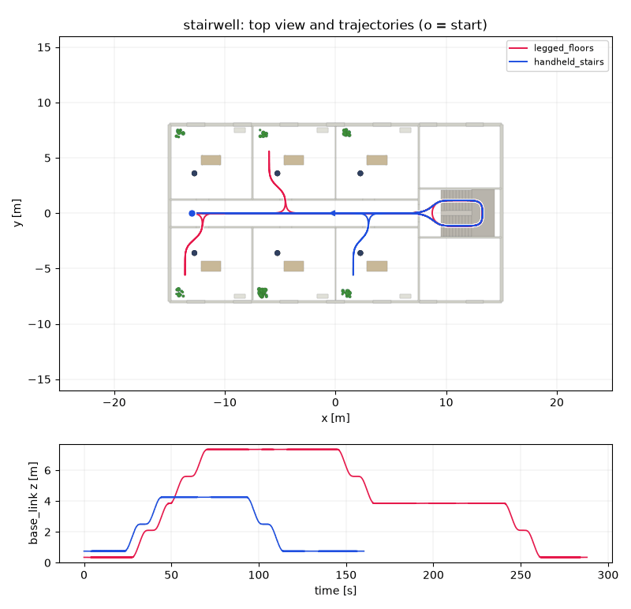

# stairwell

A three-storey building (30 x 16 m, 3.5 m floor to floor) with a U-shaped stairwell (two flights of 10 steps, 17.5 cm risers, 28 cm treads, 32 deg, per storey, plus mid landings), a corridor and furnished rooms on each floor, slabs with ceilings, and windows. Stresses stairs (fast z changes with large pitch for a legged carrier), narrow spaces, ceilings and multi-floor ambiguity (identical floor layouts).

Extent of the plotted area: 50 x 32 m; 441 ray-traced primitives.






| trajectory | carrier | duration | length | max speed | max pitch / roll | z range | description |
|---|---|---|---|---|---|---|---|
| `dog_floors` | dog | 3:49 | 163 m | 1.4 m/s | 30 / 2 deg | 7.0 m | Robot dog: up both storeys by the U-shaped stairs, a room on the first floor, and straight back down |
| `legged_floors` | legged | 4:48 | 207 m | 1.0 m/s | 32 / 1 deg | 7.0 m | Legged robot: up two storeys by the stairs, rooms, and back down, body pitched with the stairs |
| `handheld_stairs` | handheld | 2:40 | 118 m | 1.2 m/s | 7 / 1 deg | 3.5 m | Handheld rig, upright: up one storey and back down |

Regenerate only this world:

```bash
tools/build_worlds.py stairwell
tools/generate.py --worlds stairwell
```
