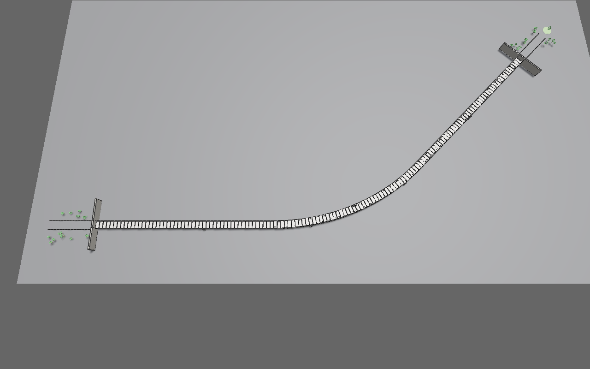
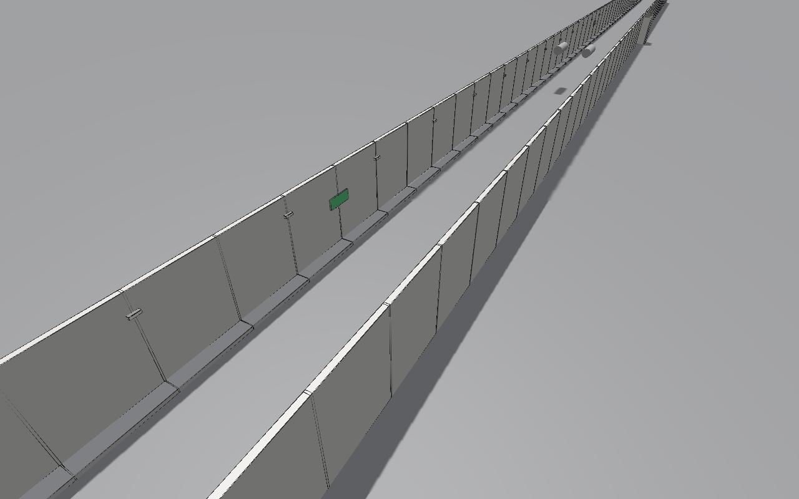
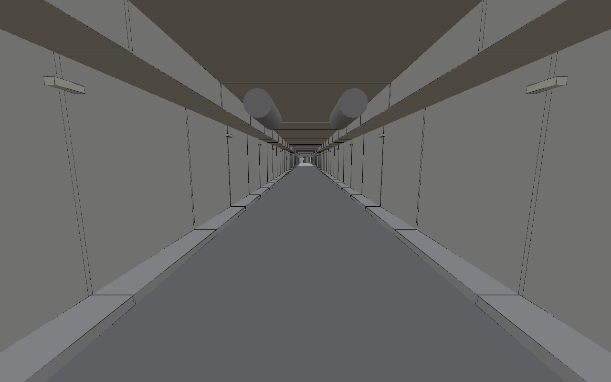
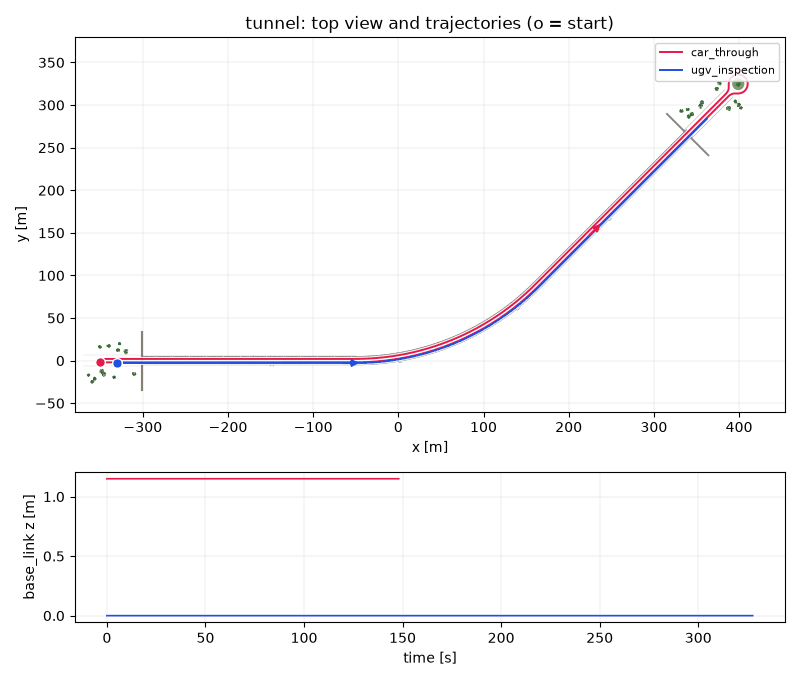

# tunnel

A 735 m road tunnel (straight, a 300 m radius 45 deg bend, straight), 10 m wide and 6.5 m high with a stepped arch, raised walkways, lamps every 10 m, signs every 100 m, emergency niches every 150 m and jet fan pairs every 200 m, with portals and a turnaround area outside. The classic degenerate case: almost nothing constrains motion along the axis.

Extent of the plotted area: 834 x 440 m; 2430 ray-traced primitives.







| trajectory | carrier | duration | length | max speed | max pitch / roll | z range | description |
|---|---|---|---|---|---|---|---|
| `car_through` | car | 2:28 | 1782 m | 15.0 m/s | 0 / 0 deg | 0.0 m | Car, 15 m/s, through the tunnel, turnaround, and back |
| `ugv_inspection` | ugv | 5:28 | 798 m | 2.5 m/s | 0 / 0 deg | 0.0 m | UGV, 2.5 m/s, once through the tunnel near the right wall |

Regenerate only this world:

```bash
tools/build_worlds.py tunnel
tools/generate.py --worlds tunnel
```
