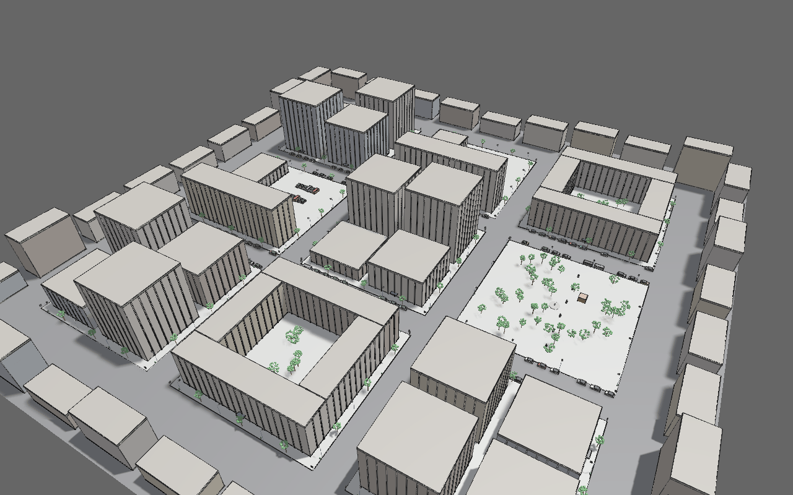
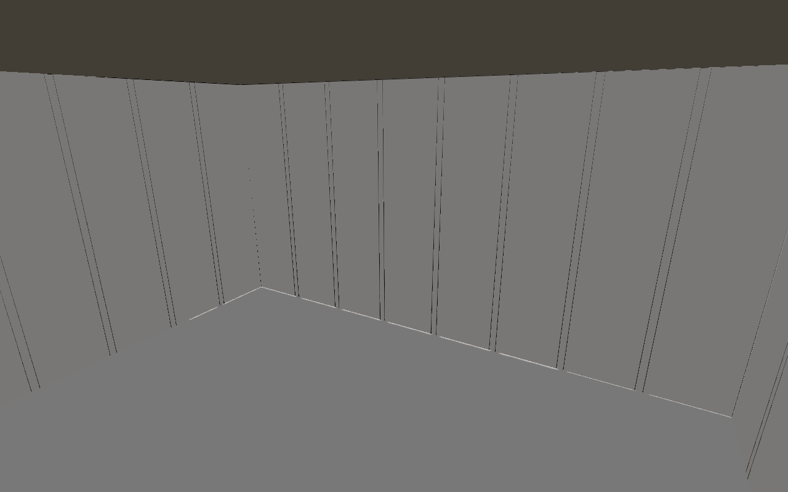
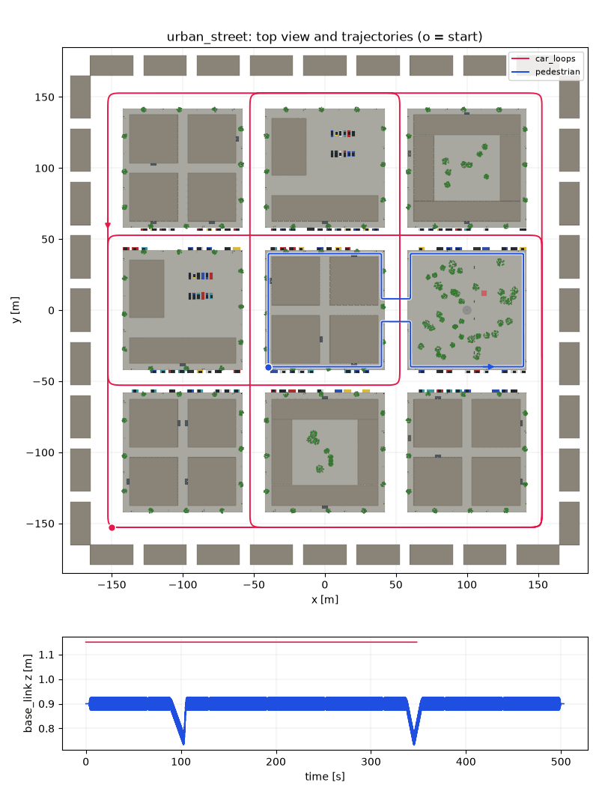

# urban_street

A 3 x 3 grid of city blocks (~370 x 370 m) with 16 m wide streets, raised sidewalks with curbs, buildings 8-45 m tall with facade relief, a courtyard block, a park block, parked cars, street trees, lamp posts, benches, bins, bus stops, sign posts and traffic lights. Well-constrained, structured scene; the car route revisits streets (loops).

Extent of the plotted area: 370 x 370 m; 8015 ray-traced primitives.






| trajectory | carrier | duration | length | max speed | max pitch / roll | z range | description |
|---|---|---|---|---|---|---|---|
| `car_loops` | car | 5:48 | 2935 m | 10.0 m/s | 0 / 0 deg | 0.0 m | Car, 10 m/s, outer ring plus two inner loops (revisits) |
| `pedestrian` | handheld | 8:23 | 671 m | 1.5 m/s | 5 / 2 deg | 0.2 m | Handheld rig walking the sidewalks of two blocks |

Regenerate only this world:

```bash
tools/build_worlds.py urban_street
tools/generate.py --worlds urban_street
```
