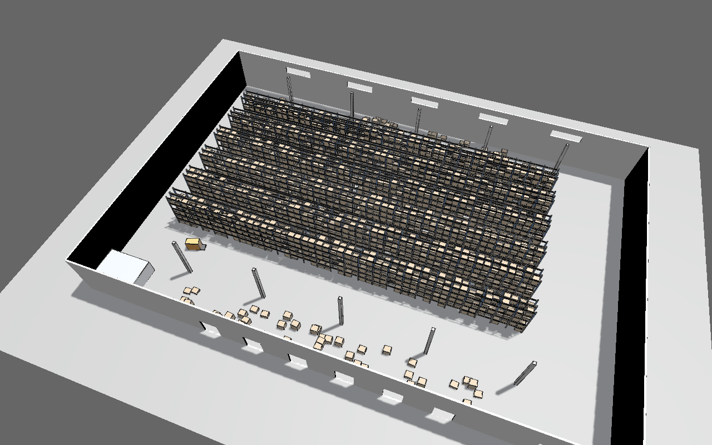
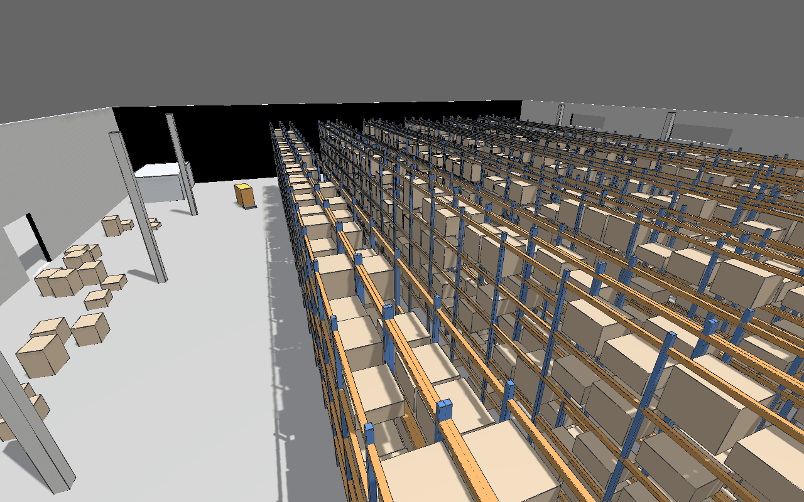
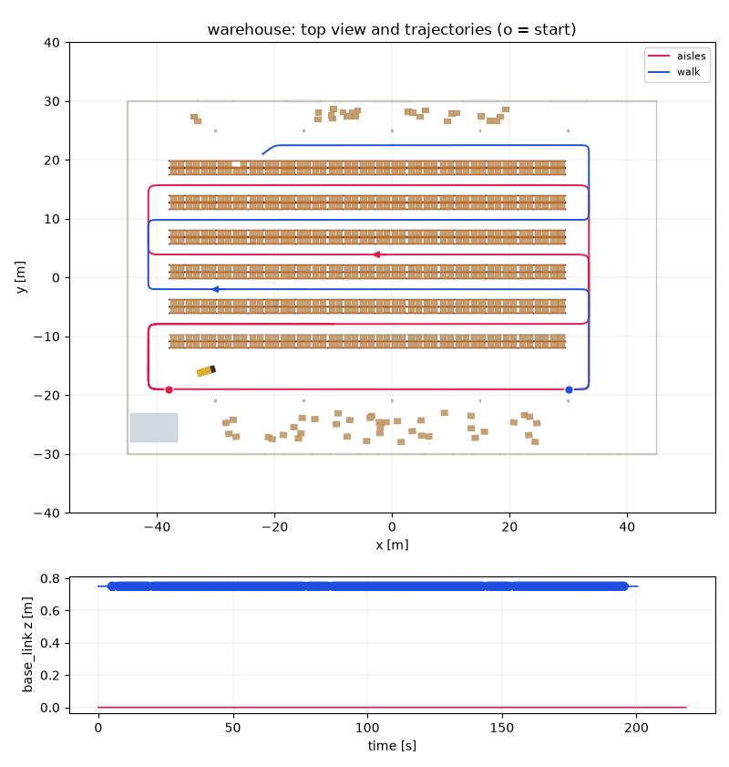

# warehouse

A 90 x 60 m logistics hall, 10 m high with a ceiling and roof trusses, six double rows of 8 m pallet racks (5 levels, randomly filled) separated by 3.6 m aisles, loading docks with door openings, staging areas with pallets and an office cabin. Indoor and repetitive: the aisles look alike, with long, nearly identical views along them.

Extent of the plotted area: 110 x 80 m; 2962 ray-traced primitives.






| trajectory | carrier | duration | length | max speed | max pitch / roll | z range | description |
|---|---|---|---|---|---|---|---|
| `aisles` | ugv | 3:38 | 410 m | 2.0 m/s | 0 / 0 deg | 0.0 m | UGV, 2 m/s, through three aisles and around, with a revisit |
| `walk` | handheld | 3:20 | 260 m | 1.4 m/s | 1 / 2 deg | 0.1 m | Handheld rig through two other aisles and the north staging area |

Regenerate only this world:

```bash
tools/build_worlds.py warehouse
tools/generate.py --worlds warehouse
```
